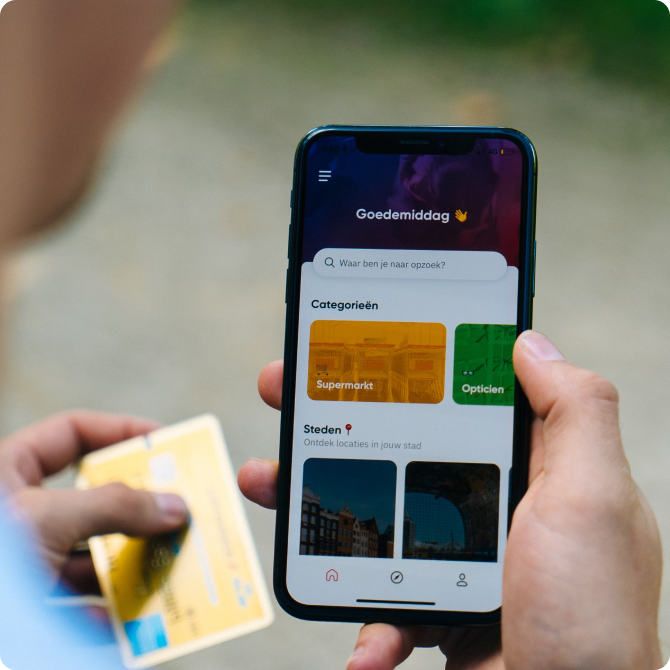

# Binam Nepal — Portfolio

Personal portfolio site for **Binam Nepal**, a web developer based in Kathmandu, Nepal.
Single-page React application with dark mode, smooth scrolling, scroll-triggered
animations, and a working contact form.

**Live:** https://binamnepal.vercel.app



## Tech stack

| Area | Tools |
|---|---|
| Framework | React 19, Vite 7 |
| Styling | Tailwind CSS 3, class-based dark mode |
| Animation | Framer Motion, Lenis (smooth scroll) |
| Forms | Formik + Yup validation, Web3Forms delivery |
| Routing | React Router 7 |
| Languages | English / German / French, built-in lightweight i18n (no extra dependency) |
| Hosting | Vercel |

## Getting started

```bash
git clone https://github.com/binamnepal/Portfolio.git
cd Portfolio
npm install

cp .env.example .env   # then add your Web3Forms key
npm run dev
```

Open http://localhost:5173.

### Environment variables

| Variable | Purpose |
|---|---|
| `VITE_WEB3FORMS_KEY` | Free access key from [web3forms.com](https://web3forms.com). Contact form submissions are emailed to you. Without it the form shows a fallback message with a direct email address. |

Set the same variable in **Vercel → Project Settings → Environment Variables** for production.

## Scripts

| Command | Description |
|---|---|
| `npm run dev` | Start the dev server with HMR |
| `npm run build` | Production build to `dist/` |
| `npm run preview` | Preview the production build locally |
| `npm run lint` | Run ESLint |

## Project structure

```
src/
├─ components/Homepage/   # Header, About, Skills, Work, Services, Testimonials, Notes, Contact, Footer, Navbar
├─ pages/                 # ProjectDetail (/work/:slug), PostDetail (/notes/:slug), NotFound
├─ data/                  # projects.js, posts.js, testimonials.js — edit content here
├─ i18n/                  # I18nProvider, useI18n(), config.js, locales/en.js, de.js, fr.js
├─ layout/
│  ├─ MainLayout.jsx      # Navbar + Footer shell + scroll-to-hash + Analytics
│  └─ App-layout.jsx      # Composes the single scrolling page
├─ routes/AppRoute.jsx
├─ index.css
└─ main.jsx
```

### Adding a project

Projects live in `src/data/projects.js` — shared between the homepage grid
and each project's `/work/:slug` case-study page. Leave `live` or `code` as
an empty string and that button won't render; fill in `role`, `problem`,
`approach` and `result` to replace the TODO placeholders.

```js
{
    slug: 'project-name',
    name: 'Project name',
    image: '/assets/work-2.png',
    description: 'One sentence on what it does and who it is for.',
    stack: ['React', 'Node.js'],
    live: 'https://…',
    code: 'https://github.com/…',
    role: 'Your role on the project',
    problem: 'What problem this solved.',
    approach: 'Your technical approach.',
    result: 'The outcome.',
}
```

### Adding a note (blog post)

Add an entry to `src/data/posts.js`. It appears on the homepage automatically
and gets its own page at `/notes/:slug`.

### Adding a testimonial

`src/data/testimonials.js` starts empty on purpose — add a real quote (with
permission) and the Testimonials section will render automatically.

### Analytics

`@vercel/analytics` is wired in and activates automatically once deployed on
Vercel — no extra setup needed. It's silent in local dev.

## License

All rights reserved © Binam Nepal.

## Languages (English / German / French)

The navbar has a language menu (EN / DE / FR). The choice is saved in `localStorage`; on a
first visit the site follows the browser language (German and French browsers get their
language, everything else English).

- **UI text** lives in `src/i18n/locales/en.js`, `de.js` and `fr.js`. Use it in a component with
  `const { t } = useI18n();` then `t('nav.about')`. A key missing from `de.js` falls back to English.
- **Project and blog text** stays in English in `src/data/projects.js` / `posts.js`. translated
  versions go under `projects[<slug>]` / `posts[<slug>]` in each locale file; any field you leave out shows in English.
- **Adding a language** (e.g. Spanish): create `locales/es.js` (copy `en.js`), register it in
  `src/i18n/config.js` (`DICTIONARIES` and `LANGUAGES`) and add its code to the `supported` list in the
  inline script in `index.html`. Non-Latin scripts also need a matching Google Font in `index.html`.
- **CV:** `header.cvFile` in each locale file points at the PDF for that language. All currently use the
  English CV — drop a translated PDF into `public/assets/` and update that locale file when you have one.
- `<html lang>`, the page title and the meta description update with the language. Social-preview
  tags (Open Graph / Twitter) in `index.html` are static and stay English.
